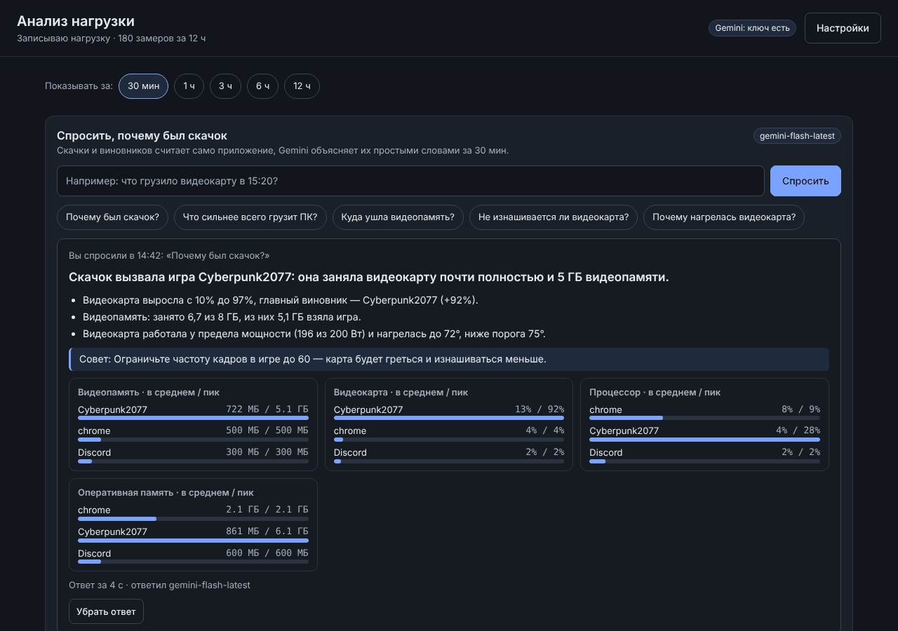
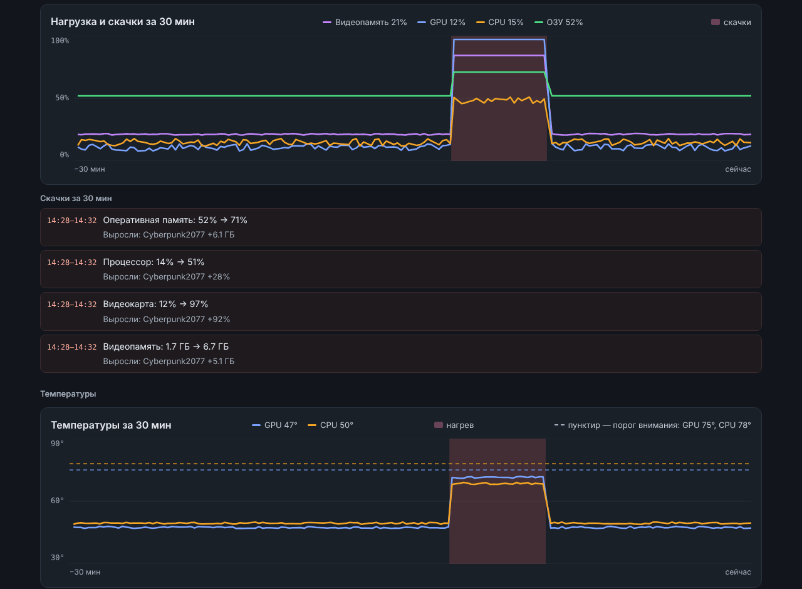

# Анализ нагрузки ПК · LoadAnalyzer


> A small Windows app that records which programs load your PC (CPU, GPU, RAM, VRAM,
> temperatures, GPU power), finds load spikes and their culprits, and can explain them
> in plain words with Google Gemini. Everything runs locally in a browser window;
> the interface is in Russian.



Небольшое приложение для Windows: показывает, какие программы грузят компьютер
(процессор, видеокарту, оперативную и видеопамять), находит скачки нагрузки и
подсвечивает их на графиках. Если добавить ключ Google Gemini, можно спросить
обычными словами «почему был скачок?» — и ИИ разберёт журнал и объяснит.

Всё показывается прямо в окне приложения. Телеграма, локальной модели и
уведомлений здесь нет — только анализ нагрузки.

## Что оно умеет



- **Журнал нагрузки.** Каждые 10 секунд записывает, сколько берёт каждая заметная
  программа, и общую загрузку ПК. Хранит 12 часов (меняется в настройках, от 1 до
  72 часов). Журнал лежит в файле и переживает перезапуск.
- **Графики за выбранный отрезок** — 30 минут, час, 3, 6 или 12 часов. Скачки
  нагрузки подсвечены, рядом — кто их вызвал.
- **Температуры** видеокарты и процессора с порогами внимания, полосы и список
  нагрева с виновниками.
- **Питание видеокарты** — мощность, напряжение ядра, частота, вентилятор и
  сводка «износа» за отрезок.
- **Разбор от ИИ (Gemini).** Скачки и виновников считает само приложение, а
  Gemini объясняет их простыми словами. Нужен бесплатный ключ (см. ниже).
  По умолчанию модель `gemini-flash-latest` — быстрая и дешёвая.

## Как запустить

1. Нужен установленный Python 3.10 или новее (команда `py` в командной строке) — его можно
   поставить с <https://www.python.org/downloads/>. Скачайте проект: зелёная кнопка
   «Code» → «Download ZIP», распакуйте в любую папку.
2. Двойным щелчком — `run.bat`. Он один раз поставит библиотеку `psutil` и
   запустит приложение. Откроется окно в браузере (Edge без адресной строки,
   иначе в браузере по умолчанию).
3. Чтобы закрыть — закройте чёрное окно консоли.

Окно также открывается по адресу `http://localhost:8777`.

## Ключ Gemini (для ответов ИИ)

Без ключа работает всё, кроме текстового разбора: графики, скачки, температуры,
питание видны и так.

1. Откройте в приложении «Настройки» → кнопка «Где взять ключ» (или зайдите на
   <https://aistudio.google.com/apikey>). Ключ бесплатный.
2. Вставьте ключ в поле «Ключ Gemini» и нажмите «Сохранить».

Ключ хранится **только на этом ПК** в файле `data/secrets.json`, не попадает на
GitHub (он в `.gitignore`), не пишется в журнал и не показывается обратно в окне.
Имя модели можно поменять в настройках (например, на `gemini-3.8-flash`).

## Температура процессора

Windows сама температуру процессора не отдаёт. Её показывает бесплатная программа
**LibreHardwareMonitor**: поставьте её, включите `Options → Remote Web Server`
(порт 8085) — и температура процессора появится в приложении сама. При первом
запуске, если программа не найдена, приложение покажет подсказку и может открыть
страницу загрузки:
<https://github.com/LibreHardwareMonitor/LibreHardwareMonitor/releases>

Температура и загрузка видеокарты NVIDIA берутся из `nvidia-smi` (ставится вместе
с драйвером), для этого ничего настраивать не нужно.

## Настройки

Всё меняется в окне «Настройки» и применяется сразу (кроме порта окна — он
меняется после перезапуска):

- модель Gemini, длина ответа, сколько ждать ответа, «размышления» модели;
- сколько часов хранить журнал и какой отрезок показывать на графиках;
- как часто делать замер;
- адрес LibreHardwareMonitor и пороги внимания для температур;
- с какой загрузки видеокарты считать, что «идёт игра».

## Проверка (тесты)

```
py -m unittest discover -s tests
```

Тесты не требуют интернета, настоящих датчиков и ключа — всё подменяется.

## Из чего состоит

- `analyzer/app.py` — запуск: настройки, сбор нагрузки, сервер, окно.
- `analyzer/monitor.py` — сбор журнала и ответы на вопросы.
- `analyzer/core/` — настройки, ключ, журнал нагрузки (файл), журнал событий.
- `analyzer/services/` — датчики: программы (`procs.py`), загрузка (`load.py`),
  температуры (`sensors.py`), питание видеокарты (`gpu_power.py`), поиск скачков и
  выжимка для ИИ (`spikes.py`), запрос к Gemini (`gemini.py`).
- `analyzer/web/` — локальный сервер и окно (весь интерфейс в одном `index.html`).
- `tests/` — проверки.

Зависимости — минимум: только `psutil` (список программ). Без неё приложение тоже
работает, но без разбивки по программам.

## Что остаётся на вашем ПК

Приложение слушает только `127.0.0.1` — из сети оно недоступно. Журнал нагрузки, настройки
и ключ лежат в папках `data/` и `config/` рядом с программой и никуда не отправляются.
В интернет уходит только вопрос к Gemini — и только когда вы сами нажали «Спросить»:
короткая выжимка журнала (какие программы сколько брали) и ваш вопрос.

## Лицензия

MIT — см. файл [LICENSE](LICENSE).
